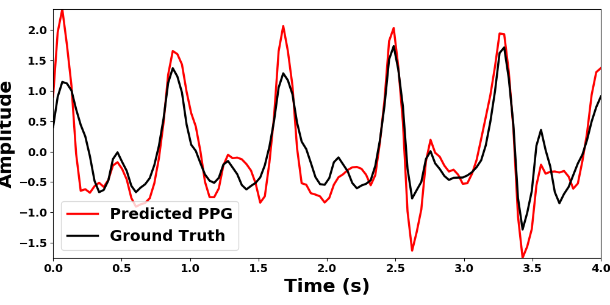
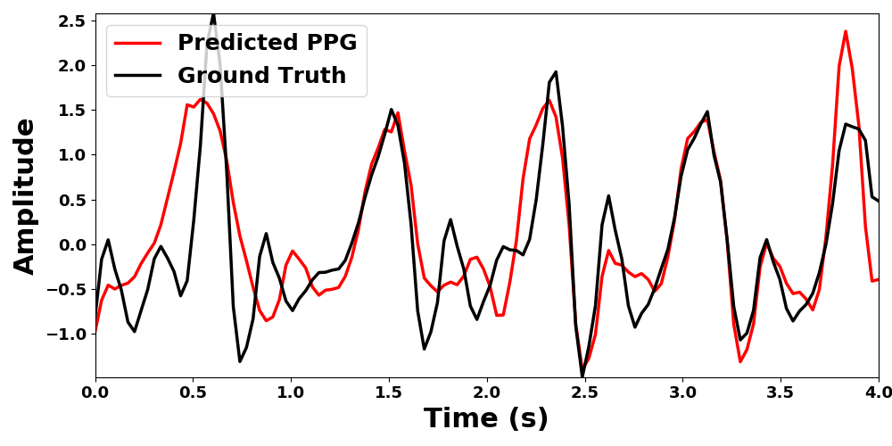
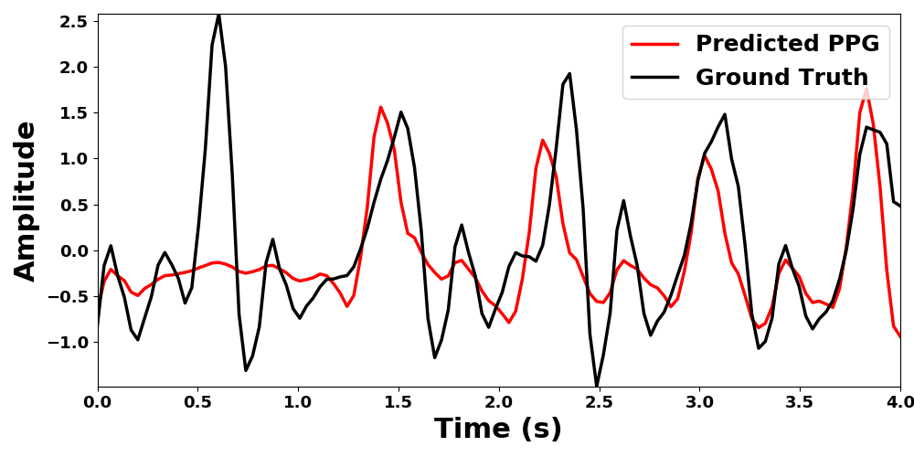

# rPPG Research — Robust Physiological Signal Estimation

Recovering a pulse waveform from facial video requires more than detecting a periodic color change: head movement, illumination, ROI selection, and signal alignment can all distort the result. This repository preserves a collaborative University of Dayton research pipeline for remote photoplethysmography (rPPG), together with my implementation, integration, and experimental work as a Computer Science and Mathematics student.

**Research advisor:** Dr. Tianming Zhao. **My role:** Logan McKinney — ROI implementation, motion-feature integration, training diagnostics, and experiments. The toolbox, published architectures, and team model comparison are credited separately below.

[Approach](#research-approach) · [Results](#experimental-results-and-ablations) · [My contributions](#my-contributions--logan-mckinney) · [Setup](#setup-and-reproduction) · [Evidence and attribution](docs/PROVENANCE.md)

## Background and motivation

Small changes in skin reflectance carry information about blood volume pulse (BVP). rPPG attempts to recover this information with a camera. Heart-rate agreement alone does not establish that a model reconstructs the waveform contour: a plausible dominant frequency can coexist with poor peaks, troughs, and overall signal shape.

Our research builds on [rPPG-Toolbox](https://github.com/ubicomplab/rPPG-Toolbox), DeepPhys, and TS-CAN, and investigates waveform supervision and artifact mitigation from two ISVC 2024 papers: [multi-task waveform recovery](https://doi.org/10.1007/978-3-031-77392-1_37) and [noise-aware post-processing](https://doi.org/10.1007/978-3-031-77392-1_35). These methods originate with their authors; this repository contains later collaborative extensions and integrations. It is research software, with no established clinical accuracy.

## Research approach

The pipeline crops facial ROIs, constructs difference-normalized and appearance channels, chunks frames and reference signals, and routes them through a model and trainer. The model family uses appearance attention, Temporal Shift Modules (TSM), and LSTMs. Multi-task supervision combines waveform reconstruction with peak, trough, and SNR objectives. The combined variant adds an artifact-removal branch conditioned on auxiliary features.


*Original team methodology figure, retained with permission. It describes the intended framework, including luminance and distance/quality inputs. It is not a claim that every illustrated extractor is implemented. In the current combined model, eight auxiliary channels plus the base rPPG signal feed a nine-channel Conv1D input, followed by a two-layer LSTM and dynamic affine correction `y(t) = a(t)x(t) + b(t)`.*

| Variant | Role in the original comparison | What the retained code contains |
| --- | --- | --- |
| [TS_CAN_v1](neural_methods/model/TS_CAN_v1.py) | Upgraded baseline | Two-stream attention/TSM backbone, LSTM, waveform and auxiliary heads. |
| [TS_CAN_Adam](neural_methods/model/TS_CAN_Adam.py) | Baseline + noise-aware post-processing | Pulse/noise paths with linear subtraction; its name is a model identifier, not merely an optimizer setting. |
| [DeepPhysMultiTask](neural_methods/model/DeepPhysMultiTask.py) | Baseline + customized multitask loss | Waveform, peak, and trough outputs; the trainer supplies the multi-loss objective. |
| [DeepPhysMultiTask_v1](neural_methods/model/DeepPhysMultiTask_v1.py) | Combined loss + post-processing | Optional measured motion input, heuristic auxiliary fallback, and affine denoising branch. |

The four-way ablation labels are preserved from the shared README. The current snapshot contains subsequent changes; it is not a frozen implementation of the experiments behind that table. In particular, TS_CAN_Adam uses subtractive denoising, while the current combined model uses affine correction. See [implementation discrepancies](docs/RESULTS.md#conditions-and-reproducibility-gaps).

## Experimental setup

The shared research README reports **training on 70% of UBFC-rPPG and testing on PURE**. The table below retains that report without assigning the runs to me or claiming independent reproduction. Surviving UBFC configs use a 0.0–0.7 training range, a 0.7–0.8 validation range, and a 0.8–1.0 PURE test range; the exact evaluated PURE coverage therefore needs confirmation.

The evaluation combines FFT-derived heart-rate errors and heart-rate Pearson correlation with waveform MSE, PSNR, correlation, SNR, DTW, and peak measures. In the retained evaluator, `Pearson` correlates predicted and reference **HR estimates**; `Correlation` compares reconstructed waveforms. These are different measurements. The SNR implementation uses the reference waveform and reconstruction residual, rather than a generic claim of a standardized spectral SNR. Details and all retained values are in [Results](docs/RESULTS.md).

## Experimental results and ablations

**Previously documented team results — UBFC → PURE; not rerun during portfolio preparation.**

| Model | HR MAE ↓ (bpm) | HR RMSE ↓ (bpm) | HR Pearson r ↑ | SNR ↑ (dB) | Waveform correlation ρ ↑ |
| --- | ---: | ---: | ---: | ---: | ---: |
| TS_CAN_v1 | 11.76 | 27.55 | 0.23 | -0.28 | 0.47 |
| TS_CAN_Adam | 5.79 | 17.95 | 0.59 | **0.25** | **0.53** |
| DeepPhysMultiTask | **4.28** | **12.06** | **0.79** | -0.28 | 0.47 |
| DeepPhysMultiTask_v1 | 4.72 | 14.02 | 0.73 | -0.04 | 0.50 |

The loss-only model has the lowest documented MAE/RMSE and highest HR Pearson correlation. The post-processing variant has the highest reported SNR and waveform correlation. The combined model improves on the baseline in these reported metrics, but does not lead every measure. No uncertainty estimates or repeated-run statistics accompany the original table, so these observations do not establish statistical significance.



*Original reported waveform example for DeepPhysMultiTask under the shared README's cross-dataset setting. Retained as a qualitative illustration; the original documentation does not provide a subject/run mapping sufficient to independently verify it.*

<details>
<summary>Full detailed ablation metrics and challenging waveform examples</summary>

| Metric | TS_CAN_v1 | TS_CAN_Adam | DeepPhysMultiTask | DeepPhysMultiTask_v1 |
| --- | ---: | ---: | ---: | ---: |
| FFT MAPE | 24.26 | 11.89 | 8.77 | 9.37 |
| Waveform MSE | 1.07 | 0.94 | 1.07 | 1.01 |
| Waveform PSNR | 19.12 | 19.65 | 19.12 | 19.36 |
| Average DTW distance | 9.98 | 9.44 | 10.08 | 9.76 |
| Peak shape score | 0.53 | 0.47 | 0.53 | 0.50 |
| Average peak amplitude distance | 1.29 | 1.30 | 1.09 | 1.00 |

The original report presents these as a challenging-case comparison:




All seven original research figures are indexed in the [figure register](docs/FIGURES.md), including the additional post-processing examples. No replacement results were generated.

</details>

## My Contributions — Logan McKinney

### Configurable ROI extraction and verification

I implemented the modular ROI approach researched by **Matthew Dowell**, connecting the extractor interface and YAML settings to preprocessing so Haar Cascade and MediaPipe FaceMesh could be selected without changing downstream model code. I integrated region choices for the glabella, forehead, cheeks, nose, and full face; the documented experiments chiefly concern glabella and Haar crops, not a completed benchmark of every region.

I investigated flat predictions and traced one failure to MediaPipe silently returning full-frame fallback crops on every frame. My progress reports document visual crop checks, switching to static-image detection, disabling iris refinement, and padding the narrow glabella crop. Those settings and fallback diagnostics are present in [roi_extractor.py](dataset/extraction/roi_extractor.py), with integration in [BaseLoader.py](dataset/data_loader/BaseLoader.py) and [config.py](config.py). The slides show a working extraction shape check and preprocessing logs; the standalone `test_mediapipe.py` mentioned there is not in this snapshot. **Evidence:** E02–E04 in the [contribution evidence register](docs/PROVENANCE.md#contribution-evidence-register).

### Motion-feature pipeline integration

I integrated **Patrick Conley's** facial-motion outputs into the learning pipeline rather than developing his underlying trackers. I implemented batch extraction support for PURE, loading/chunking motion arrays alongside video and labels, and passing eight-channel motion tensors through the shared trainer only for the combined model. The retained [PURELoader.py](dataset/data_loader/PURELoader.py), [AyaLoader.py](dataset/data_loader/AyaLoader.py), [BaseLoader.py](dataset/data_loader/BaseLoader.py), [batch runner](tools/run_motion_extraction.py), and [multitask trainer](neural_methods/trainer/DeepPhysMultiTaskTrainer.py) show these interfaces.

The PURE path consumes MediaPipe CSV fields for head translation velocity, lip velocity/acceleration, pose, and left-eye openness. The Daily path consumes collaborator-generated pose and regional-motion CSVs associated with a 3DDFA_V2 workflow. I diagnosed missing files, session-path issues, feature scaling, and channel semantics. A later slide reports corrected Daily yaw/pitch-rate channels, but **the retained code still differentiates eye-centroid positions**; I do not present that correction as completed in this copy. **Evidence:** E05, E06, E09.

### Training, signal processing, and debugging

I corrected temporal grouping by passing configured chunk length into the multitask model, gated the motion keyword argument so the baseline still uses its original call interface, and initialized the affine noise head to identity so it starts with `a=1, b=0`. I also investigated waveform collapse, removed an amplitude-weighted training-loss formulation, reduced the SNR loss weight, and applied wavelet processing per chunk before flattening training labels. These changes and diagnostics are visible in the [trainer](neural_methods/trainer/DeepPhysMultiTaskTrainer.py) and [combined model](neural_methods/model/DeepPhysMultiTask_v1.py).

I added and used synthetic model checks and diagnostics for shape, signal range, gradients, and NaN/Inf values. My reports also document headless plotting and DTW fixes. The loss and preprocessing changes were experimental debugging steps, not proof that collapse was fully resolved or that one suspected cause explains every failed run. Timestamp alignment and proportional trimming in the Daily loader reflect **Fangshi's feedback**, which I applied as part of team integration. **Evidence:** E04, E06, E08, E09, E10.

### Experiments and failure analysis

I ran and presented PURE ROI/motion experiments and Daily Nodding experiments, tracking FFT HR error, HR correlation, waveform correlation, SNR, and DTW. A reported 10-epoch PURE comparison favored the Haar baseline over glabella + motion (MAE 0.22 vs 4.03 bpm); both ROI and motion differed, so it does not isolate the value of motion features. Daily experiments exposed weak waveform recovery and a regression after adding motion, which motivated the channel and normalization investigation.

The [separate experiment summary](docs/LOGAN_EXPERIMENTS.md) preserves these outcomes and their conditions. I treated fixed/global motion normalization, 28-ROI quality selection, SQI gating, and broader motion-condition testing as proposed next steps unless supported by completed evidence. I do not claim the shared UBFC → PURE table as my independent result. **Evidence:** E06–E10.

## Repository structure

```text
main.py / config.py        Entry point, trainer routing, configuration defaults
dataset/data_loader/       Video/label loading, alignment, preprocessing, motion clips
dataset/extraction/        Configurable Haar / MediaPipe ROI interface
neural_methods/model/      Four research variants and inherited comparison models
neural_methods/trainer/    Training, losses, checkpointing, waveform reconstruction
evaluation/               HR and waveform metrics and post-processing
unsupervised_methods/     Inherited POS, CHROM, ICA, GREEN, PBV, and LGI baselines
configs/                  Retained training and inference recipes, portable path examples
tools/                    PURE motion batch runner and synthetic model checks
Images/                   Original approved research diagrams and plots
docs/                     Evidence, full results, dataset/setup guidance, validation
```

This is one canonical source tree. Raw recordings, physiological measurements, caches, private slide decks, model weights, and standalone third-party tracker repositories are excluded.

## Setup and reproduction

Run from the repository root. The original environment used Python 3.8, PyTorch 1.12.1, and MediaPipe 0.10.5. Historical pins are preserved in [requirements.txt](requirements.txt), with missing imported utilities listed explicitly. This is **not a fully resolved lockfile**; the old NumPy/h5py/SciPy combination needs compatibility review before treating environment recreation as verified. Preparation checks used the already installed environment; no large frameworks were installed.

```bash
# Optional historical environment starting point; creates a new environment.
bash setup.sh
conda activate rppg-portfolio
python -m pip install -r requirements.txt

# Synthetic CPU model checks: no datasets or weights required.
python tools/test_model_unit.py
```

Obtain datasets through their owners, keep them outside Git, and edit `DATA_PATH`, `CACHED_PATH`, device settings, and checkpoint paths before any real run. Set `DO_PREPROCESS: True` for the initial preprocessing pass, then disable it when reusing a compatible cache. Do not reuse caches across different ROI/channel/motion settings. All checkpoint files must be obtained separately with appropriate rights.

| Purpose | Existing configuration |
| --- | --- |
| UBFC → PURE upgraded baseline | [UBFC_UBFC_PURE_TSCAN_BASIC_v1.yaml](configs/train_configs/UBFC_UBFC_PURE_TSCAN_BASIC_v1.yaml) |
| UBFC → PURE subtractive post-processing | [UBFC_UBFC_PURE_TSCAN_BASIC_adam.yaml](configs/train_configs/UBFC_UBFC_PURE_TSCAN_BASIC_adam.yaml) |
| PURE multitask loss recipe | [PURE_PURE_UBFC_DEEPPHYSMULTITASK.yaml](configs/train_configs/PURE_PURE_UBFC_DEEPPHYSMULTITASK.yaml) |
| PURE glabella + measured motion recipe | [PURE_PURE_UBFC_DEEPPHYSMULTITASK_v1.yaml](configs/train_configs/PURE_PURE_UBFC_DEEPPHYSMULTITASK_v1.yaml) |
| Daily/Aya experiment | [Daily_Daily_Daily_DeepPhysMultiTask.yaml](configs/train_configs/Daily_Daily_Daily_DeepPhysMultiTask.yaml) |

Names are inherited: inspect `DATASET`, `MODEL.NAME`, `BEGIN/END`, and `TOOLBOX_MODE` rather than assuming the filename states the active experiment. The v1 PURE recipe actually tests PURE; the Daily recipe currently selects `only_test` and the v1 model. These settings are preserved rather than silently converted into new experiments.

```bash
# Training example, after dataset/config/environment preparation:
python main.py --config_file configs/train_configs/PURE_PURE_UBFC_TSCAN_BASIC.yaml

# Inference requires a separately supplied compatible checkpoint:
python main.py --config_file configs/infer_configs/PURE_UBFC_TSCAN_BASIC.yaml

# Classical signal-processing baseline; requires locally authorized UBFC data:
python main.py --config_file configs/infer_configs/UBFC_UNSUPERVISED.yaml
```

The inherited PURE → UBFC example uses an 80%/20% PURE training/validation split; this is separate from the reported 70% UBFC experiment. [Setup and dataset guide](docs/SETUP_AND_DATASETS.md) retains parameter descriptions, dataset layouts, SCAMPS examples, motion-feature setup, and loader extension guidance.

## Limitations

- The team result table is a historical report; exact checkpoints, run logs, subject mappings, and uncertainty estimates are not bundled.
- Daily/Aya is an internal collaborative dataset with restricted availability and no verified public citation. Daily results cover a narrow Nodding/70-lux subset, with low waveform correlations and documented motion regressions. No broad robustness or clinical-generalization claim follows.
- Motion padding/truncation, zero fallback, per-clip normalization, and Daily frame/CSV alignment require care. Missing motion files do not constitute a measured-motion ablation: the loader supplies zeros, while direct model calls with `None` use heuristic features.
- Region names describe configured landmark sets, not validated anatomical segmentation for every region. The glabella-oriented padding/vertical crop is shared across region choices in this snapshot.
- Legacy dependencies, fixed spatial/channel assumptions, and train/validation loss differences remain documented in [Results](docs/RESULTS.md). Algorithms and trained-model behavior were not redesigned for this portfolio.

## References and acknowledgments

This work was conducted collaboratively at the University of Dayton with **Dr. Tianming Zhao** as my advisor. **Fangshi Zhou** provided research direction and code-review feedback; the shared README labels the four-model extension as Fangshi's work. **Matthew Dowell** researched the ROI approach that I implemented. **Patrick Conley** contributed facial-motion tracking and the 3DDFA-related workflow whose outputs I integrated. Unresolved line-level authorship remains collaborative; an upload commit is not evidence that its uploader wrote every file.

- **Toolbox:** Xin Liu et al., *rPPG-Toolbox: Deep Remote PPG Toolbox*, NeurIPS 2023. [Paper](https://arxiv.org/abs/2210.00716) · [Original repository](https://github.com/ubicomplab/rPPG-Toolbox).
- **Multi-task waveform model:** Fangshi Zhou, Tianming Zhao, Adam Holsinger, and Zhongmei Yao. *Accurate Remote PPG Waveform Recovery from Video Using a Multi-task Learning Temporal Model*, ISVC 2024, LNCS 15046, pp. 493–506. [Publisher](https://doi.org/10.1007/978-3-031-77392-1_37).
- **Noise-aware post-processing:** Adam Holsinger, Fangshi Zhou, Tianming Zhao, and Zhongmei Yao. *Motion and Light Artifact Mitigation for Remote PPG with Noise-Aware Post-processor Network*, ISVC 2024, LNCS 15046, pp. 467–479. [Publisher](https://doi.org/10.1007/978-3-031-77392-1_35). Both ISVC chapters first appeared online in January 2025.
- **DeepPhys:** Weixuan Chen and Daniel McDuff, ECCV 2018. [Paper](https://arxiv.org/abs/1805.07888).
- **TS-CAN / MTTS-CAN:** Xin Liu et al., *Multi-Task Temporal Shift Attention Networks for On-Device Contactless Vitals Measurement*, NeurIPS 2020. [Paper](https://arxiv.org/abs/2006.03790).
- **3DDFA_V2:** Jianzhu Guo et al., *Towards Fast, Accurate and Stable 3D Dense Face Alignment*, ECCV 2020. [Original project](https://github.com/cleardusk/3DDFA_V2). Its source, weights, and Patrick's standalone tracker are not bundled.

The upstream toolbox uses the **Responsible Artificial Intelligence Source Code License, version 1.1**, reproduced in [LICENSE](LICENSE). Its restrictions apply to upstream-derived work; users and downstream distributors must comply with Section 3.2. This project is not relicensed as MIT. Existing copyright notices, including the Intel/OpenCV cascade notice, remain intact. See [third-party notices](THIRD_PARTY_NOTICES.md) and [provenance](docs/PROVENANCE.md) for historical source lineage and contributor attribution.
